# Horizon Imager

**Manage master images for VMware vSphere and Omnissa Horizon from one web console.**
See every master VM and its snapshots, open its console in the browser, take, revert and delete
snapshots, replicate an image to another vCenter, and push a snapshot to Horizon desktop pools, with
sign-in through Active Directory, role-based permissions and a full audit log.

<p align="center">
  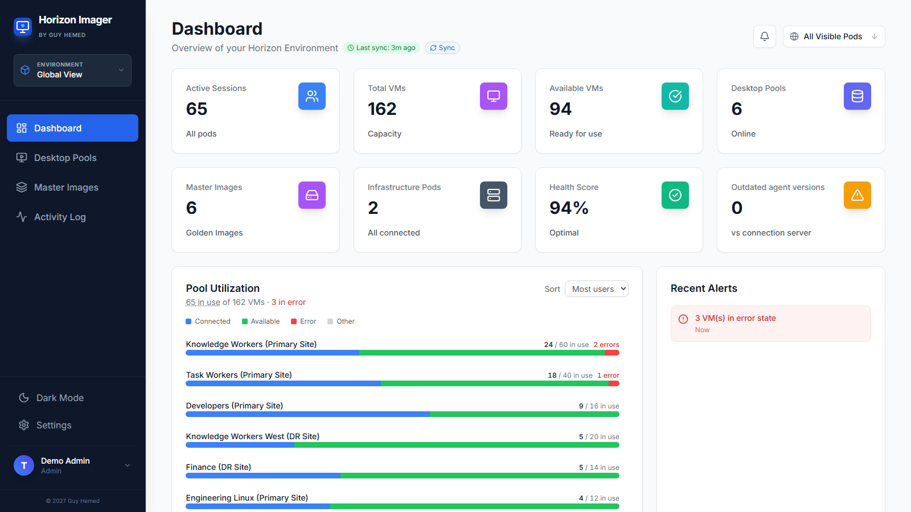
</p>

This repository holds the **ready-to-run releases**: the Windows installer, a Docker Compose file and the
documentation. Download, install, open the page in your browser, and a setup wizard does the rest. The source code is
private and is not published here.

## Get it

| | Windows | Docker |
|---|---|---|
| **For** | A Windows Server 2019+ machine, installed as a service | Any Docker host (Linux, or Docker Desktop on Windows) |
| **Get** | **[Releases](../../releases/latest)**: download `EUC-Imager-Installer-<version>.exe` | `docker compose` with [docker/docker-compose.yml](docker/docker-compose.yml) |
| **Database** | SQLite built in, or your PostgreSQL / SQL Server | PostgreSQL included in the compose file, or your SQL Server |
| **Updates** | Run the new installer over the old one; data is kept | `docker compose pull && docker compose up -d` |

### Windows installer

1. Download `EUC-Imager-Installer-<version>.exe` (for example `EUC-Imager-Installer-1.1.0.exe`) from the [latest release](../../releases/latest) and check it against
   `SHA256SUMS.txt` from the same page: `Get-FileHash .\EUC-Imager-Installer-<version>.exe`.
2. Run it as an administrator. It installs one Windows service (**EUC Imager Backend**), opens ports 443 and 80 in the
   firewall and shows the **setup token** on the last page.
3. Open `https://localhost/` (or the server's name). The browser warns once, because the server first presents a
   self-signed certificate; install your own in **Settings, Security** (see [HTTPS](#https)).
4. Enter the setup token and follow the wizard.

Upgrading from a version that used nginx: the installer keeps your certificate, removes the nginx service and serves
HTTPS itself.

### Docker

Needs Docker Desktop (Windows, macOS) or Docker Engine with Compose v2 (Linux), running. Nothing else: the keys are made by the image itself, so Python is not needed.

**Windows PowerShell**

```powershell
mkdir euc-imager; cd euc-imager
curl.exe -O https://raw.githubusercontent.com/ghemed/EUC-Imager-Releases/main/docker/docker-compose.yml
curl.exe -O https://raw.githubusercontent.com/ghemed/EUC-Imager-Releases/main/docker/.env.example
Copy-Item .env.example .env
docker run --rm ghcr.io/ghemed/euc-imager:1.1.0 python -c "import secrets; print(secrets.token_urlsafe(48))"
docker run --rm ghcr.io/ghemed/euc-imager:1.1.0 python -c "from cryptography.fernet import Fernet; print(Fernet.generate_key().decode())"
notepad .env
docker compose up -d
```

**Linux or macOS**: the same, with `curl -O` and `cp .env.example .env` instead of the first lines.

In `.env`, paste the first generated value after `SECRET_KEY=`, the second after `AD_ENCRYPTION_KEY=`, and choose a password after `POSTGRES_PASSWORD=`. Keep `AD_ENCRYPTION_KEY` safe: without it the stored vCenter and Horizon passwords cannot be read again.

Wait about a minute, then open `https://localhost` and accept the self-signed certificate warning (you can install your own later in *Settings, Security*). The setup wizard asks for the setup token:

```powershell
docker compose exec app cat /data/setup-token.txt
```

If ports 443 or 80 are already used on the host, set `HTTPS_PORT` and `HTTP_PORT` in `.env` (for example `8443` and `8080`), restart with `docker compose up -d`, and open the console on that port.

Update to a new version: `docker compose pull` then `docker compose up -d` (set `EUC_VERSION` in `.env` to pick the version). Stop with `docker compose down`; the data stays in the `appdata` and `pgdata` volumes. `docker compose down -v` deletes that data.

Everything the app stores (database for SQLite, keys, certificate) is in the `appdata` volume; PostgreSQL has its own.

## What it does

<table>
<tr>
<td width="50%">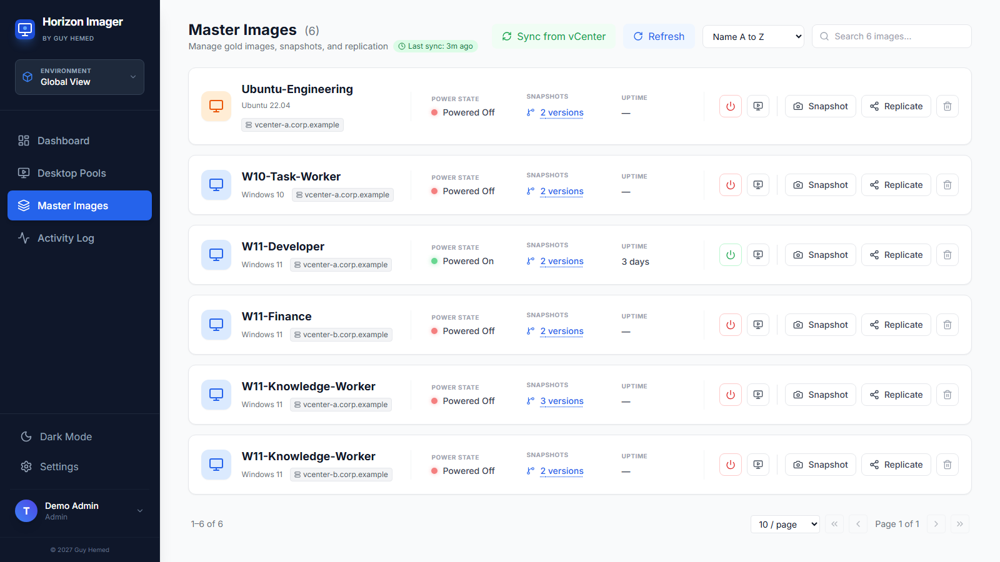<br><b>Master images</b>: every master VM per vCenter, power state, snapshot count, console, snapshot, replicate.</td>
<td width="50%">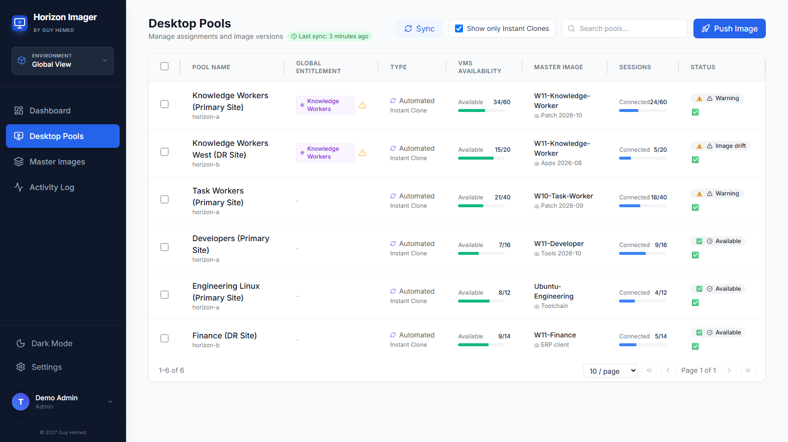<br><b>Desktop pools</b>: availability, sessions, master image and snapshot per pool, image drift and pending push at a glance.</td>
</tr>
<tr>
<td>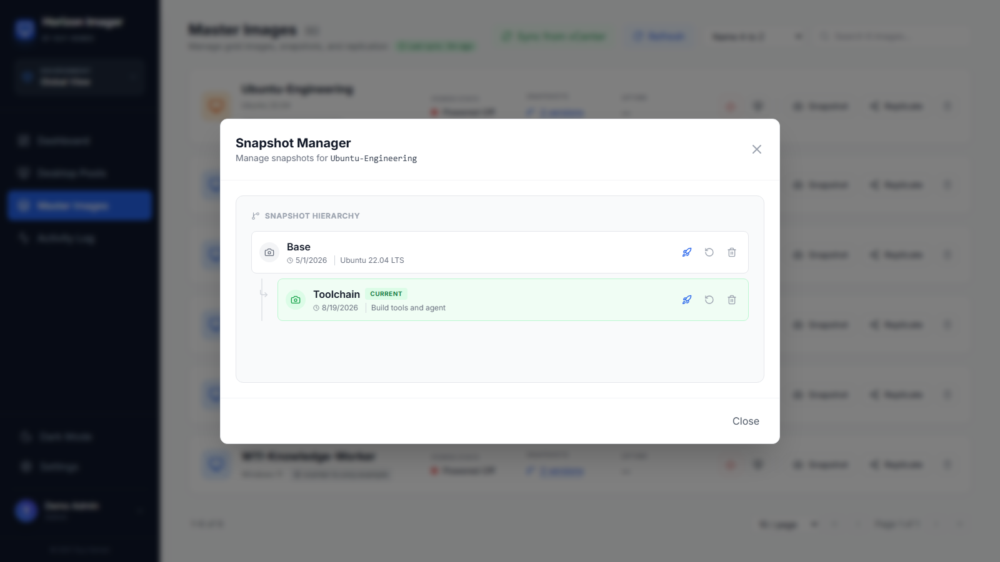<br><b>Snapshot manager</b>: take, revert and delete snapshots in the app; deploy a snapshot to pools.</td>
<td>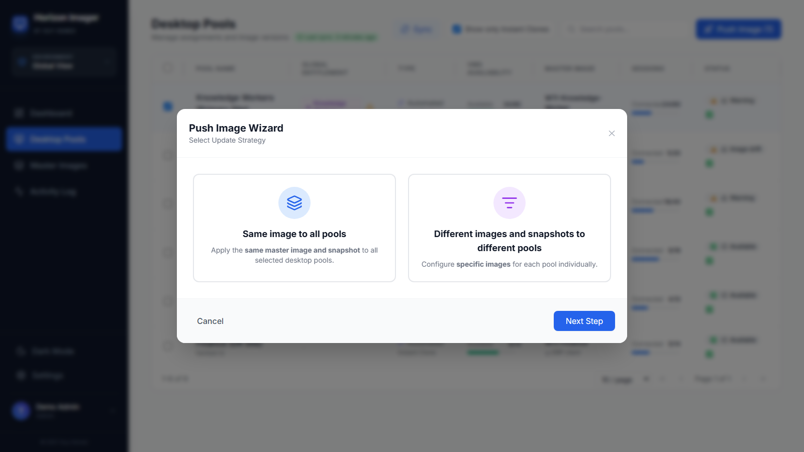<br><b>Push image</b>: one image to all pools or one per pool, with a schedule and log-off policy, checked pool by pool.</td>
</tr>
<tr>
<td>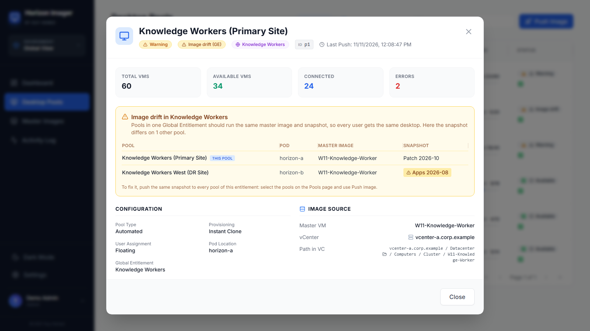<br><b>Image drift</b>: pools of one Global Entitlement that do not run the same image are compared side by side.</td>
<td>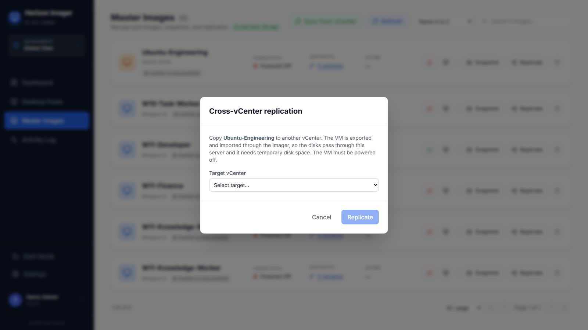<br><b>Replicate to another vCenter</b> through the Imager, with progress, for a powered-off master image.</td>
</tr>
<tr>
<td>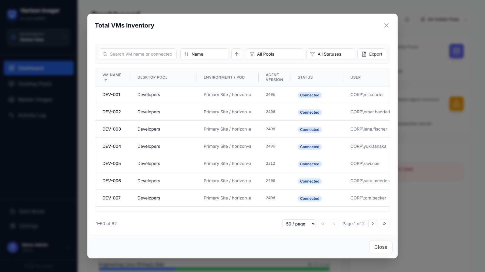<br><b>Inventory</b>: every VM and session with environment, pod, status, user and uptime; export to CSV.</td>
<td>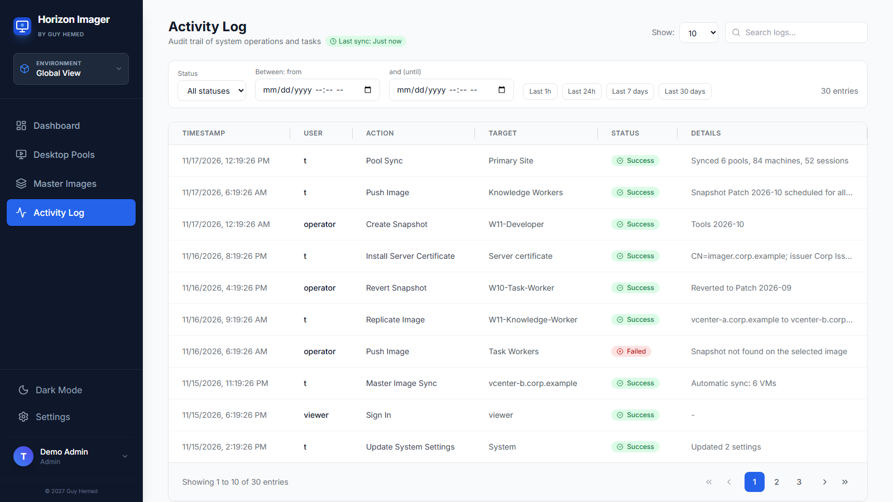<br><b>Activity log</b>: every sign-in, sync, snapshot, push and delete with user, target and result; filter by status and date.</td>
</tr>
</table>

Also: an **in-browser VM console** that works without any network path from users to ESXi hosts, **automatic
synchronisation** of data older than a configurable number of hours, an **alert center** and a **task indicator** that
shows whether a sync, replication or image push is running, **multiple environments** (each with its vCenters and Horizon
pods) with a Global View, and **dark mode**.

<p align="center">
  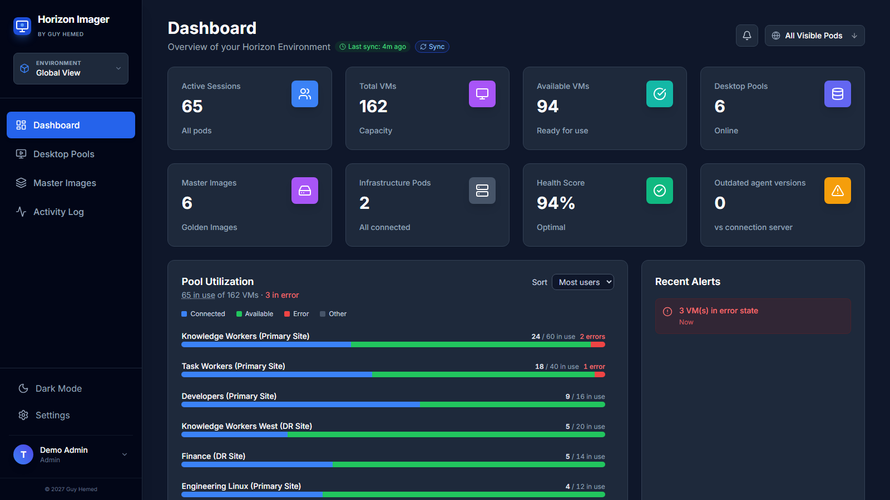
</p>

### Administration

<table>
<tr>
<td width="50%">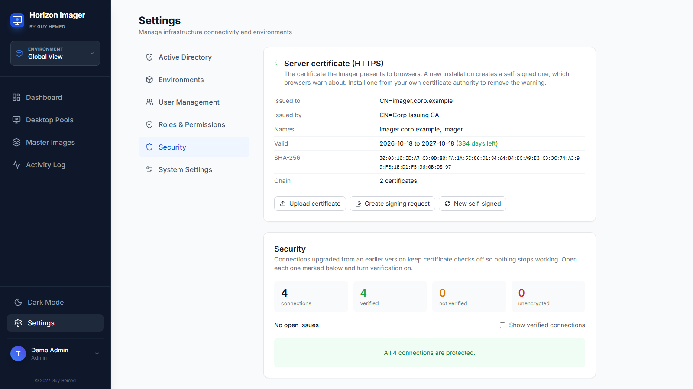<br><b>HTTPS</b>: install your own certificate (PEM, PFX or a signing request created on the server).</td>
<td width="50%">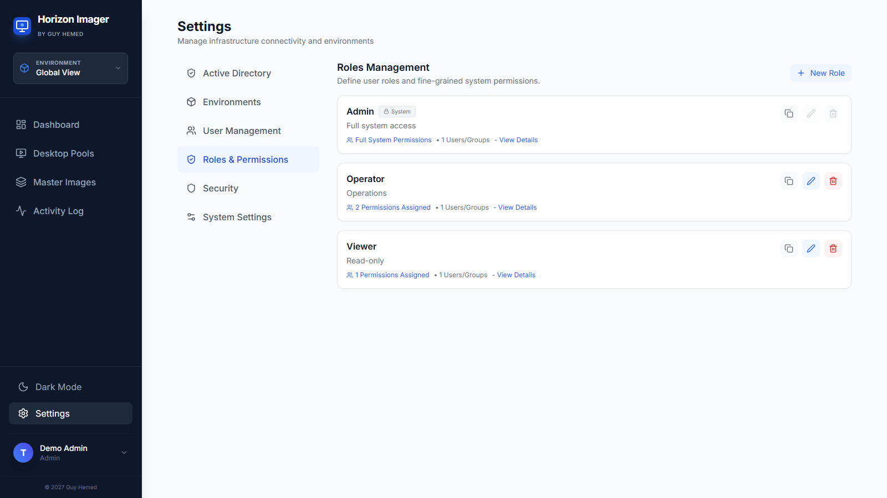<br><b>Roles and permissions</b>: what each role may do; the server enforces it and the UI hides what a user cannot use.</td>
</tr>
<tr>
<td>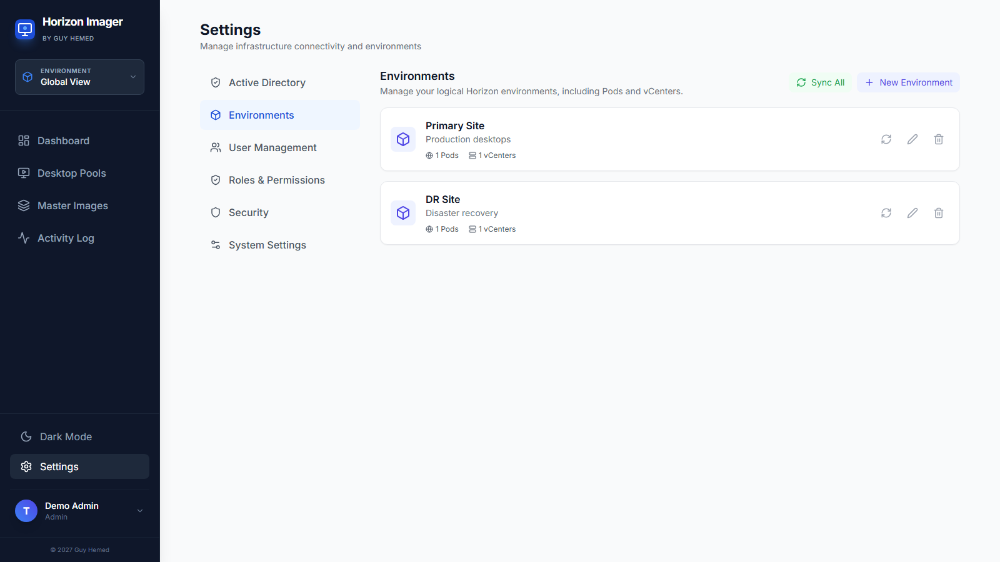<br><b>Environments</b>: vCenters and Horizon Connection Servers, each with its own certificate check.</td>
<td>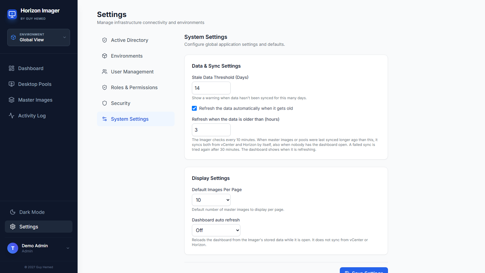<br><b>System settings</b>: automatic sync interval, dashboard refresh, page sizes.</td>
</tr>
</table>

## Requirements

Short version; the full list (sizing, ports, accounts, privileges) is in [docs/PREREQUISITES.md](docs/PREREQUISITES.md).

| | |
|---|---|
| **vSphere** | vCenter and ESXi 7.0 or 8.0 |
| **Horizon** | Omnissa Horizon Connection Server 2603 or later (instant clone pools for push) |
| **Directory** | Active Directory for sign-in (LDAPS, StartTLS or LDAP); a local break-glass administrator is optional |
| **Server (Windows)** | Windows Server 2019 or later, 64-bit. Lab: 2 vCPU, 4 GB RAM, 10 GB disk; up to about 20,000 VMs: 4 vCPU, 8 GB, 40 GB (plus free space for replication, which stages disks temporarily) |
| **Server (Docker)** | Docker Engine 24+ with Compose v2 |
| **Database** | SQLite (built in, for labs and small installs), PostgreSQL 13+ (tested with 16) or Microsoft SQL Server 2017+ (needs ODBC Driver 18) |
| **Browser** | Current Chrome, Edge or Firefox |
| **Accounts** | A read-and-operate service account in vCenter, an administrator-level read account in Horizon, an AD service account for sign-in lookups |

**Network** (all from the Imager server unless noted):

| To | Port | Purpose |
|---|---|---|
| Users' browsers → Imager | 443/TCP (80 redirects to 443) | Web UI and the console WebSocket |
| vCenter | 443/TCP | Inventory, power, snapshots, console tickets |
| Every ESXi host with a master VM | 443/TCP | Console relay (users never talk to ESXi) |
| Horizon Connection Server | 443/TCP | Pools, push image, health |
| Domain controllers | 636/TCP (LDAPS) or 389/TCP | Sign-in and group lookup |
| Database server (external only) | 5432/TCP or 1433/TCP | PostgreSQL or SQL Server |

Replicating an image between vCenters streams the disks through the Imager: see the network notes in
[docs/PREREQUISITES.md](docs/PREREQUISITES.md#cross-vcenter-image-replication).

## First sign-in

There is no default account. The first time you open the page, a setup wizard asks for the **setup token** (shown at the end of
the Windows installation, or in `setup-token.txt` in the data folder), then lets you choose the database, connect Active
Directory, pick the administrator groups or users, optionally create a local break-glass administrator, and add your first
environment with its vCenters and Horizon pods.

## HTTPS

The Imager serves HTTPS itself (TLS 1.2 or newer) and only redirects plain HTTP. On first start it creates a self-signed
certificate. In **Settings, Security, Server certificate** an administrator can:

* **upload** a certificate (PEM certificate with its key and chain, or a PFX/P12 file), or
* **create a signing request** on the server (the private key never leaves it), send it to the certificate authority and
  install the answer, or
* create a new self-signed certificate.

A new certificate is used after **Restart now** in the same card. The alert center warns 30 days before it expires. Session
cookies are marked Secure and HSTS is sent when the certificate is not self-signed. Details: [SECURITY.md](SECURITY.md).

## Roles and permissions

Roles are edited in **Settings, Roles**. The default roles are **Admin** (everything), **Operator** (view images, push to
pools, which also allows syncing) and **Viewer** (read only). Anyone signed in can read the dashboard, pools, images and the
activity log.

| Permission | Allows |
|---|---|
| `console_access` | Open VM consoles |
| `snapshot_manage` | Create, revert and delete snapshots |
| `pool_push` | Push images to pools (also allows syncing) |
| `image_manage` | Sync master images and pools; replicate images |
| `image_delete` | Delete a master image from disk (only Admin by default) |
| `vm_power` | Power master VMs on and off |
| `env_manage` | Add, change and delete environments, vCenters and Connection Servers; test connections; fetch certificates |
| `user_manage` | Active Directory sign-in settings, users, roles, group mappings, system settings and the server certificate |
| `all` | Everything |

## Documentation

* [docs/USER_GUIDE.md](docs/USER_GUIDE.md): how each screen works
* [docs/PREREQUISITES.md](docs/PREREQUISITES.md): software, sizing, ports, accounts and privileges in full
* [SECURITY.md](SECURITY.md): how secrets, certificates and permissions are handled
* [CHANGELOG.md](CHANGELOG.md): what changed in each release

## Support

Questions and problems: open an [issue](https://github.com/ghemed/EUC-Imager-Releases/issues) in this repository. Include
the version (shown in the installer and in the release name), what you did and what the Activity Log or the server log says; never
paste passwords or the contents of the data folder.

## License

[MIT](LICENSE) © Guy Hemed
